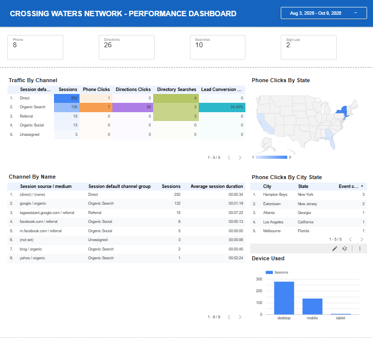

# CWN Analytics Tracking

GA4 event tracking and a Data Studio performance dashboard for a nationwide mental health directory.

## Index
- [Goal](#goal)
- [Description](#description)
- [Tracking Plan](#tracking-plan)
- [Dashboard](#dashboard)
- [Skills](#skills)
- [Technology](#technology)
- [Results](#results)
- [Limitations](#limitations)
- [Repository Structure](#repository-structure)

## Goal
Measure what visitors actually do on a directory site, not just how many arrive, so decisions about content and marketing can be based on actions such as calling a provider or asking for directions.

## Description
This repo documents the analytics setup for [CrossingWatersNetwork.org](https://crossingwatersnetwork.org), a nationwide directory of mental health treatment facilities. Custom events are tracked through Google Tag Manager and sent to GA4. A Data Studio dashboard turns those events into a simple performance view: traffic, device mix, traffic sources and a lead conversion rate.

This is documentation only. No account IDs, container IDs or credentials are included.

## Tracking Plan
Events are configured as custom tags in Google Tag Manager and sent to GA4.

| Tag | Event | What it tells us |
|---|---|---|
| GA4 Configuration | page and session data | Base traffic measurement |
| Directory Search | `directory_search` | What visitors look for |
| Facility Directions Click | `facility_directions_click` | A visitor plans to go to a facility |
| Provider Phone Click | `provider_phone_click` | A visitor intends to call a provider |
| Newsletter Sign-up | `newsletter_signup` | Email subscriber growth (once the signup form is live) |

## Dashboard


Built in Data Studio on top of the GA4 data. It includes:
- **Traffic overview:** sessions and users over time
- **Device breakdown:** desktop, mobile and tablet use
- **Source / medium:** where visitors come from, including organic search
- **Lead conversion:** a calculated rate for visitors who took a high-intent action
- **Event table:** counts for each tracked action

**Lead Conversion** is calculated as:

```
(Phone Clicks + Directions Clicks) / Sessions
```

It is formatted as a percentage. Event data and session data are combined with a blend that uses explicit join keys.

A plain-English glossary of each metric is in [`docs/metrics-glossary.md`](docs/metrics-glossary.md).

## Skills
Web analytics, GA4 configuration, event tracking, Google Tag Manager, dashboard design, data blending, calculated fields, KPI definition, technical documentation.

## Technology
Google Analytics 4, Google Tag Manager, Data Studio.

## Results
- Five tags are configured and sending data to GA4.
- A working dashboard shows traffic, device, source and high-intent action data in one view.
- The tracking covers a directory of 13,745 mental health treatment facility listings across all 50 states.

## Limitations
Traffic to the site is still small: 418 sessions between August 3 and October 9, 2026. At this size, the percentages and rankings are directional only and should not be read as proven trends. The value of this project is the measurement method, which is ready to scale as traffic grows.

## Repository Structure
```
cwn-analytics-tracking/
├── README.md
├── docs/
│   └── metrics-glossary.md
└── images/                 # dashboard screenshots (private data hidden)
```
