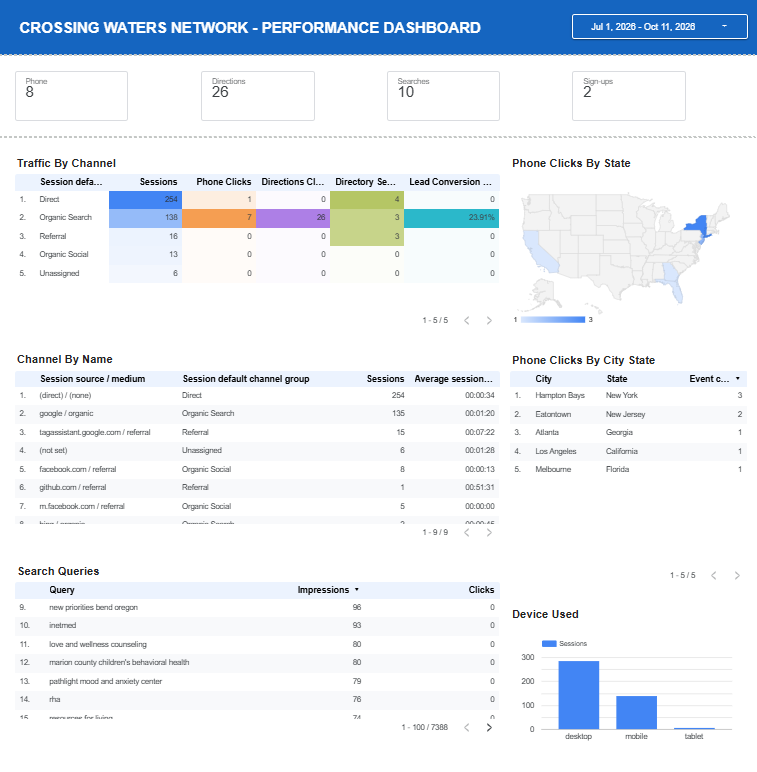

# CWN Analytics Tracking

GA4 event tracking and a Data Studio performance dashboard for a nationwide mental health directory.

## Index
- [Goal](#goal)
- [Description](#description)
- [Tracking Plan](#tracking-plan)
- [Dashboard](#dashboard)
- [Case Study](#case-study-using-search-data-to-guide-content)
- [Skills](#skills)
- [Technology](#technology)
- [Results](#results)
- [Limitations](#limitations)
- [Repository Structure](#repository-structure)

## Goal
Measure what visitors actually do on a directory site, not just how many arrive, so decisions about content and marketing can be based on actions such as calling a provider or asking for directions.

## Description
This repo documents the analytics setup for [CrossingWatersNetwork.org](https://crossingwatersnetwork.org), a nationwide directory of mental health treatment facilities. Custom events are tracked through Google Tag Manager and sent to GA4. A Data Studio dashboard turns those events into a simple performance view: traffic, device mix, traffic sources and a lead conversion rate.

This is documentation only. No account IDs, container IDs or credentials are included.

## Tracking Plan
Events are configured as custom tags in Google Tag Manager and sent to GA4.

| Tag | Event | What it tells us |
|---|---|---|
| GA4 Configuration | page and session data | Base traffic measurement |
| Directory Search | `directory_search` | What visitors look for |
| Facility Directions Click | `facility_directions_click` | A visitor plans to go to a facility |
| Provider Phone Click | `provider_phone_click` | A visitor intends to call a provider |
| Newsletter Sign-up | `newsletter_signup` | Email subscriber growth (once the signup form is live) |

## Dashboard


Built in Data Studio on top of the GA4 data. It includes:
- **Traffic overview:** sessions and users over time
- **Device breakdown:** desktop, mobile and tablet use
- **Source / medium:** where visitors come from, including organic search
- **Lead conversion:** a calculated rate for visitors who took a high-intent action
- **Event table:** counts for each tracked action

**Lead Conversion** is calculated as:

```
(Phone Clicks + Directions Clicks) / Sessions
```

It is formatted as a percentage. Event data and session data are combined with a blend that uses explicit join keys.

A plain-English glossary of each metric is in [`docs/metrics-glossary.md`](docs/metrics-glossary.md).

## Case Study: Using Search Data to Guide Content

### 1. The Business Problem
Crossing Waters Network (CWN) gets search traffic, but there was little visibility into what visitors were searching for or which channels led to action. Between July 1 and October 11, 2026, the directory of 13,745 listings produced 8 phone clicks, 26 directions clicks and 2 newsletter sign-ups. The challenge was to find which acquisition channels bring high-intent actions, and how to use search data to reach more of the visitors who were not acting.

### 2. Steps Taken
- **Event tracking:** Configured Google Analytics 4 (GA4) and Google Tag Manager to track four user actions: phone clicks, directions clicks, directory searches and newsletter sign-ups.
- **Search data:** Linked Google Search Console to GA4 and connected it to the Looker Studio dashboard.
- **Dashboard:** Built a Looker Studio dashboard showing traffic by acquisition channel, state and city, device, and search queries.
- **Lead conversion metric:** Added a calculated field for lead conversion:

```
Lead Conversion Rate = (Phone Clicks + Directions Clicks) / Sessions
```

- **Check:** For Organic Search, the dashboard shows a 23.91% lead conversion rate, which matches the hand calculation of 33 actions across 138 sessions.

### 3. What We Learned
- **Organic Search drives action.** It accounted for all 26 directions clicks and 7 of the 8 phone clicks, even though Direct traffic had more sessions.
- **Direct traffic is an open question.** Direct is the largest channel at 254 sessions but produced only 1 phone click. The cause has not been determined.
- **There is search demand the site is not capturing.** The Search Queries table returned 7,388 rows. Many of the top queries have high impressions and zero clicks. After filtering to queries with at least 50 impressions and 2 or fewer clicks, excluding branded searches, 25 remained. Of those, 18 were searches for specific facilities by name.

### 4. Recommendations
1. **Keep investing in organic search.** It is the channel that brings visitors who take action.
2. **Use search data to guide content.** Group the high-impression, low-click queries into themes and use those themes to guide the blog and newsletter content. The first run produced four themes: facility name searches, treatment types, location searches and family support.
3. **Built: a Search Console theme script.** A Python script in the `cwn-content-automation` project pulls queries from the Google Search Console API with read-only access, filters for high-impression, low-click queries, groups them into themes with keyword rules, and writes a CSV of themes with query counts and impressions. It does not list facility names. On its first run it read 7,388 rows and produced 4 themes.
4. **Future scope (not yet built):** Pass the themes to the content pipeline so they guide topic selection automatically.

## Skills
Web analytics, GA4 configuration, event tracking, Google Tag Manager, dashboard design, data blending, calculated fields, KPI definition, technical documentation.

## Technology
Google Analytics 4, Google Tag Manager, Data Studio.

## Results
- Five tags are configured and sending data to GA4.
- A working dashboard shows traffic, device, source and high-intent action data in one view.
- The tracking covers a directory of 13,745 mental health treatment facility listings across all 50 states.

## Limitations
Traffic to the site is still small: 418 sessions between August 3 and October 9, 2026. At this size, the percentages and rankings are directional only and should not be read as proven trends. The value of this project is the measurement method, which is ready to scale as traffic grows.

## Repository Structure
```
cwn-analytics-tracking/
├── README.md
├── docs/
│   └── metrics-glossary.md
└── images/                 # dashboard screenshots (private data hidden)
```
